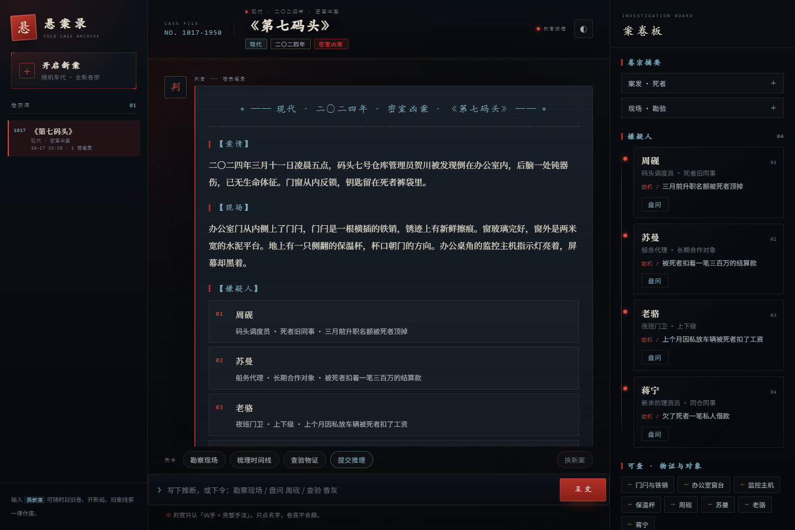

# 悬案录 · 文字探案

与判官对坐，在证词与物证的裂缝里找出真凶。每一局随机抽取年代（古代大靖 / 现代都市）与诡计类型，生成一桩全新的独立命案；四名嫌疑人各有动机，只有一人是真凶。



- **判官守卷**：不主动剧透凶手与手法；猜错只给极克制的暗示。
- **一局一案**：每案固定四名嫌疑人、一条完整时间线、若干可查物证。
- **换新案即封卷**：旧案对话与线索全部作废，在同一条卷宗线上重开，年代与诡计重新抽取，尽量不重复。
- **悬疑风界面**：午夜卷宗 / 旧纸卷宗两套底色，古代金、现代冷青两套年代强调色；右侧案卷板钉着嫌疑人档案与可查清单，点一下就能提审或查验。

## 快速开始

需要 Python 3.10 及以上。后端是 **FastAPI + uvicorn + httpx**。

```powershell
pip install -r requirements.txt
copy .env.example .env
# 用记事本打开 .env，把 DEEPSEEK_API_KEY 换成你的密钥
python main.py
```

浏览器打开 **http://127.0.0.1:8787**；接口文档在 **http://127.0.0.1:8787/docs**。

Windows 也可以直接双击 `run.bat`：它会自动尝试项目内 `.venv`、上一级共享 `.venv`，再退回全局 `python`，检查依赖、生成 `.env`，然后启动服务。

如果全局 `python` 没装 FastAPI，而机器上有共享环境，可以显式用：

```powershell
..\.venv\Scripts\python.exe main.py
```

> 密钥在 DeepSeek 开放平台申请；任何兼容 OpenAI `chat/completions` 协议的服务都能用，改 `DEEPSEEK_BASE_URL` 与 `DEEPSEEK_MODEL` 即可。

## 怎么玩

| 指令 | 作用 |
| --- | --- |
| `勘察现场` | 只看肉眼能看见的东西，不给结论 |
| `盘问 <姓名>` | 以嫌疑人第一人称回答，古案用古风白话，现代案用日常口语 |
| `查验 <物证>` | 只给检验结论：仵作验状 / 法医报告 / 监控 / 通话记录 |
| `梳理时间线` | 把各人的说法摆在一起，矛盾自己看 |
| `提交推理：<凶手 + 完整手法>` | 同时说清凶手与手法，才会结案 |
| `换新案` | 立刻封存旧卷，重新抽取年代与诡计 |

破案要同时说清三件事：**怎么致死**、**怎么布置现场或制造假象**、**关键物证或时间线怎么被利用**。只说名字，判官不会翻开卷底。

右侧案卷板上的四张嫌疑人卡可以直接点「盘问」，可查清单里的物证点一下就是「查验」；窄屏下点顶部「卷」按钮打开案卷板。

## 目录结构

```
悬案录/
├─ main.py               # FastAPI 后端：模型调用、卷宗解析、会话存档
├─ static/
│  ├─ index.html         # 页面骨架
│  ├─ style.css          # 悬疑风视觉系统（两套主题 + 年代强调色）
│  └─ app.js             # 交互、笔录排版、案卷板渲染
├─ sessions/             # 每个会话一个 JSON 卷宗（自动生成）
├─ docs/                 # 界面预览图
├─ requirements.txt
├─ .env.example
├─ run.bat
└─ README.md
```

## 配置

复制 `.env.example` 为 `.env` 后按需修改：

| 变量 | 默认值 | 说明 |
| --- | --- | --- |
| `DEEPSEEK_API_KEY` | 空 | **必填**，模型密钥；也兼容 `OPENAI_API_KEY` |
| `DEEPSEEK_BASE_URL` | `https://api.deepseek.com` | OpenAI 兼容端点，不要带 `/chat/completions` |
| `DEEPSEEK_MODEL` | `deepseek-chat` | 模型名 |
| `DEEPSEEK_TIMEOUT` | `120` | 单次调用超时（秒） |
| `HOST` | `127.0.0.1` | 监听地址；只在本机玩就不要改成 `0.0.0.0` |
| `PORT` | `8787` | 端口；若被占用或被系统拒绝，换一个即可 |
| `SESSION_DIR` | `./sessions` | 卷宗存档目录，可指向任意可写目录 |

## 接口

后端由 FastAPI 提供，启动后可在 `/docs` 直接调接口；OpenAPI 描述在 `/openapi.json`。

所有接口统一返回 `{"code": 200, "message": "...", "data": ...}`，出错时 `code` 为 HTTP 状态码，`message` 是可直接显示的中文提示。

| 方法 | 路径 | 说明 |
| --- | --- | --- |
| GET | `/api/health` | 存活检查与模型配置状态 |
| GET | `/api/sessions` | 卷宗库（标题、年代、诡计、是否结案、笔录数） |
| POST | `/api/sessions` | 新建会话并生成第一案 |
| GET | `/api/sessions/<id>` | 读取一卷（含结构化 `case` 与笔录） |
| DELETE | `/api/sessions/<id>` | 销毁一卷 |
| POST | `/api/sessions/<id>/restart` | 换新案：清空旧案，重新抽取年代与诡计 |
| POST | `/api/chat` | `{"session_id": "...", "message": "..."}`；`reset=true` 表示这一轮换了新案 |

开局文本会被后端解析成结构化的 `case`：

```json
{
  "era": "ancient",
  "era_label": "大靖",
  "year": "景和十二年",
  "type": "投毒案",
  "title": "青瓷盏",
  "scene": "……",
  "site": "……",
  "suspects": [{"index": 1, "name": "沈砚秋", "identity": "……", "relation": "……", "motive": "……"}],
  "clues": ["青瓷茶盏", "香炉残灰"]
}
```

前端据此渲染案卷头、四张嫌疑人卡和可查清单；就算模型没按格式写，开局原文仍会完整显示，不会丢内容。

## 排查

- **页面打得开但开不了案**：`.env` 里没有填 `DEEPSEEK_API_KEY`。页面会给出提示；填好后重启服务，点「重试调卷」。
- **端口起不来**：默认 `8787`；被占用或被系统拒绝时，设 `PORT=8788`（或别的端口）再启动。
- **卷宗目录不可写**：把 `SESSION_DIR` 指到一个可写目录，例如 `SESSION_DIR=D:\game-data\xuananlu`。
- **模型线路中断**：确认能访问 `DEEPSEEK_BASE_URL`；代理环境可把 base URL 指向你自己的兼容网关。
- **启动时报 `ModuleNotFoundError: fastapi`**：当前 `python` 不是装了 FastAPI 的环境。用 `..\.venv\Scripts\python.exe main.py`，或先 `pip install -r requirements.txt`；`run.bat` 会自动尝试可用的虚拟环境。
- **依赖缺失**：`pip install -r requirements.txt`（FastAPI、uvicorn、httpx）。
- **换了前端文件但没生效**：静态资源已带 `no-store`，强制刷新一次即可。

## 设计说明

界面取「深夜档案室 / 案发现场勘验板」的意象：案卷纸的横向纹理、朱砂印章、红色证物线、颗粒与暗角，配合克制的衬线排版。四种关键状态各有视觉语言——卷宗未启的封条、调卷时的呼吸灯、盘问中的红点、结案时的竖排「结案」钢印。排版不提前给出任何凶手线索，所有判断都留在卷宗正文里。

案件数据与界面结构严格对应：后端负责随机年代 / 诡计、解析开局、校验破案条件与存档；前端只做呈现与指令输入，不猜测案情。
